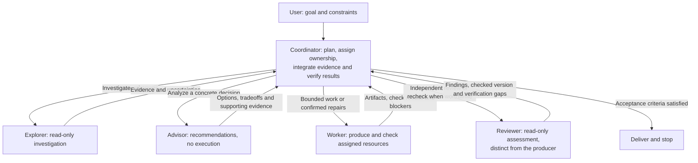

# Fox Orchestrate

A general-purpose skill for planning and coordinating useful subagent work. Invoke `$fox-orchestrate` with a goal and relevant constraints. The coordinator chooses the approach, delegation, model settings, and verification depth, then integrates the results.

Four reusable role definitions cover investigation (**Explorer**), execution (**Worker**), independent assessment (**Reviewer**), and direction or decision advice (**Advisor**). Use any useful mix; choose local work or delegation based on required quality and overall cost, including coordination and verification. Advisors receive selected necessary context in a fresh subagent, without forking an App conversation. Subject expertise and project workflows are supplied with each assignment, while overall planning remains with the coordinator.

## Role collaboration

Use roles as needed; the diagram shows responsibilities and handoffs, not a required sequence or agent count. The coordinator may complete work locally and owns integration and final acceptance.

## Files

- [SKILL.md](SKILL.md): role definitions and essential coordination guidance.
- [Model routing](references/model-routing.md): task-based selection using current runtime information, selected once before each assignment.
- [agents/openai.yaml](agents/openai.yaml): the skill's interface metadata.

## Runtime behavior

Role definitions are instructions passed to subagents; they do not register native agent types or install persistent agents. Actual permissions, concurrency, and supported initial settings come from the host runtime.

Use [model routing](references/model-routing.md) for discovery, provider boundaries, capability/effort selection, pins and fixed follow-up settings. The caller or session controls the coordinator's configuration; hard budgets require host runtime support.

Install this folder as `fox-orchestrate` in your discoverable skills directory.

## Regression tests

See [tests/README.md](tests/README.md) for the routing-only behavioral suite and offline checker tests. Run the applicable checks after skill edits; preview sample tasks are never executed. Optional isolated [live cooperation checks](tests/live-cooperation.md) provide separate execution evidence when handoff or coordination changes warrant it. These are maintenance checks, not runtime skill dependencies.

## Optional experiments

The standalone Jev helper and frozen experiment evidence are preserved in the repository-level [experiment archive](../../experiments/fox-orchestrate/README.md). They are not part of the installed skill or its runtime workflow.

## Design references

Conceptual references, not runtime dependencies:

- [OpenAI model selection](https://developers.openai.com/api/docs/guides/model-selection): task and delivery tradeoffs; recommendations are starting points to evaluate.
- [OpenAI model catalog](https://developers.openai.com/api/docs/models): current model capabilities and supported settings.
- [Practical model selection cookbook](https://developers.openai.com/cookbook/examples/partners/model_selection_guide/model_selection_guide): stage-specific selection and evaluation methods; its 2025 model and pricing examples are historical.
- [donvito/codex-astra-luna-orchestrator](https://github.com/donvito/codex-astra-luna-orchestrator): bounded assignments, resource ownership, concise evidence, and coordinator acceptance.
- [Claude Code subagents](https://code.claude.com/docs/en/sub-agents): separate contexts and explicit handoffs.
- [OpenCode agents](https://opencode.ai/v2/docs/agents): general roles and permission boundaries.
